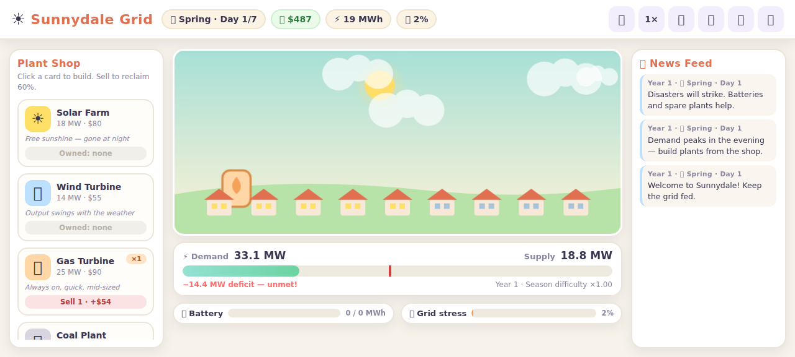
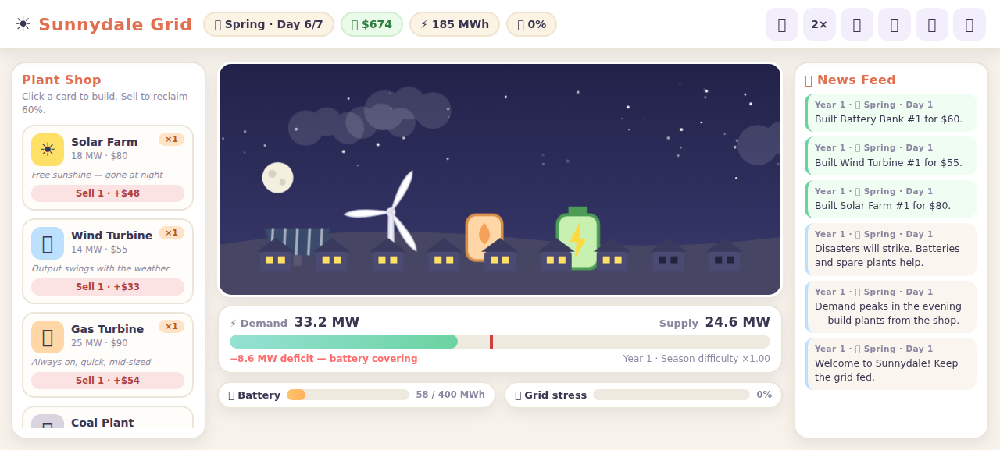
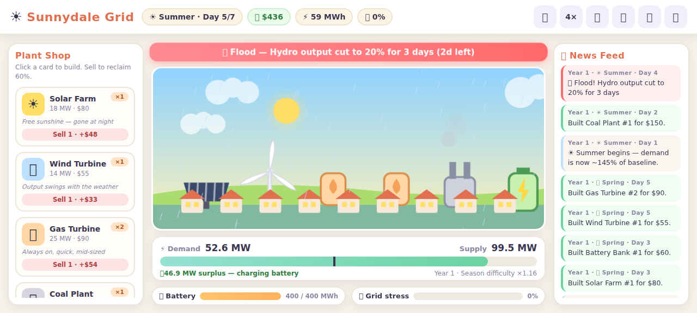
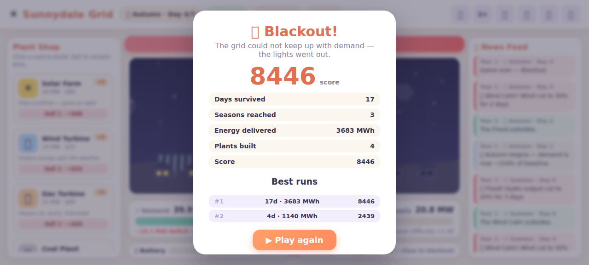

# Sunnydale Grid

A real-time browser-based power-grid management game. Every second, the simulated weather, season, and demand shift; you balance supply (build and sell power plants) to keep the lights on.



## How to run

```bash
npm start                        # serves on http://127.0.0.1:8080
npm start -- --port 3000          # serve on 3000 instead
node server.js 3000               # same thing (positional port)
PORT=3000 npm start               # same thing via env var
node server.js --help             # usage
```

If the requested port is unavailable (e.g. 8080 in use), the next free port is
used automatically and reported (e.g. "Port 8080 in use — trying 8081"). No
build step, no dependencies.

## How to play

- Click a plant card in the **Plant Shop** to buy. Click the **Sell** button on a card to resell the last one for 60% of its cost.
- Keep **Demand ≲ Supply** through the whole day. When supply falls short, battery covers it first (up to its capacity), then **Grid stress** climbs. Stress at 100% ends the run in a blackout.
- **Money** comes from energy delivered; maintenance drains a little every day. Go below $0 and the run ends in bankruptcy.
- **Battery** banks leftover surplus and discharges when there is a deficit — it is the buffer for evening peaks and disasters.
- **Disasters** strike from day 4: storms cut wind, heatwaves/cold snaps spike demand, droughts and floods cut hydro, eclipses cut solar. Each has distinct effects and on-screen effects.
- **Seasons** (7 days each) change demand, solar, and wind. Every season raises the baseline demand multiplier (`× 1.00`, `× 1.20`, `× 1.40`…) so the game gets harder.
- Pause with **Space**. Speed toggle cycles 1× / 2× / 4×.
- Game saves automatically to `localStorage` and restores on reload. Use **📤 Export** to download a save file (`.json`) and **📥 Import** to restore one later (new game or abandoned run).
- Press **▶ Play again** on the game-over screen to start a fresh run (best runs persist).

## What the game teaches you

- Day/night demand curve: the evening peak is the hardest part of every day.
- Solar is free at sunshine but nothing at night; wind swings with the weather; baseload plants run constantly.
- Batteries and baseload cover evening; a system of all solar drowns at night.
- Disasters punish misallocated mixes — a grid with only hydro dies in drought/flood.

## Screenshots

| Start | Mid-game | Disaster | Game over |
|---|---|---|---|
|  |  |  |  |

## Controls

| Key / control | Action |
|---|---|
| Click plant card | Build plant |
| Click Sell | Resell one plant (60%) |
| Space | Pause / resume |
| 1×/2×/4× button | Game speed |
| 💾 | Save now |
| 📤 / 📥 | Export / import save |
| 🔄 | New game |

## Project structure

```
index.html       markup (HUD, shop, canvas, news feed, game-over overlay)
styles.css       layout + panel styling
js/game.js       all game logic: simulation, rendering, persistence, input
server.js        zero-dependency static server (node server.js)
package.json     npm start entry
screenshots/     final screenshots
```

## Tech

Vanilla HTML/CSS/JS, no frameworks, no build step. Canvas 2D for the scene (weather, sun, clouds, plants, houses, rain/snow). Game loop uses `requestAnimationFrame`; state persists in `localStorage` and can be exported/imported as JSON.
